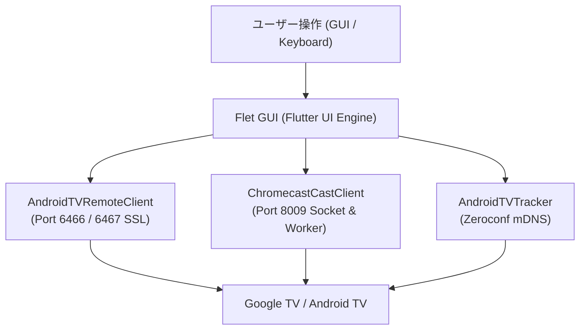

# ChromecastRemoteControl

[English](README_EN.md) | 日本語

Chromecast with Google TV / Google TV Streamer / Android TV デバイス向けの、軽量かつ高機能なデスクトップリモコン＆メディアコントローラーアプリケーションです。  
Python と [Flet](https://flet.dev/)（Flutter エンジン）をベースに構築されており、ネイティブライクなモダン UI と快適な操作性を提供します。

<p align="center">
  
</p>

---

## 主な特徴

- **完全なリモコン操作 (Android TV Remote v2)**
  - 方向キー (D-Pad)、決定、戻る、ホーム、電源、音量、消音
  - キーボードショートカット操作対応（矢印キー、Enter、Esc、Space、音量キー等）
  - キーの長押し連続送信・短押しタップの正確な判定（付属物理リモコンと同一のOS標準キーイベント送信）
  - **長押し加速早送り (Hold-to-Accelerate)**: 左右キー長押し時に物理リモコンと同様に一段階加速（2倍速・高速シーク）が自動発動
- **YouTube ダイレクト検索 (YouTube Search)**
  - アコーディオンメニューから PC キーボードでキーワードを入力し、テレビ画面や再生状態に関わらず一撃で YouTube 検索結果一覧へダイレクトジャンプ
  - 面倒なテレビ画面上のオンスクリーンキーボード操作を完全に不要化
  - 主要動画配信アプリ（YouTube, Netflix, Prime Video, U-NEXT, ABEMA, TVer 等）のワンクリック起動
- **Google Cast メディア連携 (pychromecast)**
  - 現在再生中のメディア情報（タイトル、アーティスト、アルバムアート、再生位置、総時間）のリアルタイム同期
  - 再生 / 一時停止、スキップ（次へ / 前へ）、シークバーによる任意位置へのシーク
  - 字幕（CC）のワンクリック有効化 / 無効化
  - 長いタイトルに対応する自動マーキースクロール表示
- **多言語対応 (Multilingual Support)**
  - **字幕優先言語の自動適用**: キャスト開始時に指定した優先言語コード（日本語 `ja`、英語 `en` 等）に一致する字幕トラックを自動検出して適用
  - **ワンクリック言語切り替え**: 設定パネルから優先言語を即時切り替え可能
  - **多言語ドキュメント**: 日本語 ([README.md](README.md)) および英語 ([README_EN.md](README_EN.md)) のバイリンガルドキュメントを提供
- **自動デバイス検出 & 自動再接続**
  - mDNS (Zeroconf) によるローカルネットワーク上の Android TV 自動探索
  - PC スリープ / 休止状態からの復帰を検知した自動切断クリーンアップ＆再接続
  - 起動時の前回接続デバイスへの自動接続
- **洗練されたデスクトップ UI/UX**
  - ネオングラデーションを基調としたダークサイバーパンク調デザイン
  - ウィンドウサイズに応じた動的スケーリング（フォント・ボタン寸法の自動追随）
  - ウィンドウ透明度（Opacity）スライダー調整
  - 軽量なメモリバッファリング付きデバッグロギング

---

## システム構成図



---

## 必要要件

- **OS**: Windows 10 / 11 (64-bit)
- **Python**: 3.10 以上 (Python 3.12 推奨)
- **対象デバイス**: Google TV Streamer、Chromecast with Google TV、または Android TV OS 搭載テレビ/端末（同一ローカルネットワーク内に接続）

---

## 対応デバイス一覧 & 世代・モデルによる仕様差 (重要)

本アプリケーションは、**Google TV / Android TV OS 搭載デバイス専用**のリモコンアプリです。  
従来の古い Chromecast（第1〜第3世代、Chromecast Ultra）と、Chromecast with Google TV / Google TV Streamer では、内部 OS および通信プロトコルが根本的に異なるため、動作可否が分かれます。

### デバイス対応マトリクス

| デバイス名 | 発売年 | 搭載 OS | リモコン操作<br>(Port 6467) | メディア情報同期<br>(Port 8009) | 本アプリの対応状況 |
| :--- | :---: | :--- | :---: | :---: | :---: |
| **Google TV Streamer (4K)** | 2024 | Google TV (Android 14) | ✅ 完全対応 | ✅ 完全対応 | **対応 (推奨)** |
| **Chromecast with Google TV (4K)** | 2020 | Google TV (Android 10〜12) | ✅ 完全対応 | ✅ 完全対応 | **対応 (推奨)** |
| **Chromecast with Google TV (HD)** | 2022 | Google TV (Android 12) | ✅ 完全対応 | ✅ 完全対応 | **対応 (推奨)** |
| **各社 Android TV / Google TV 搭載テレビ・STB**<br>(BRAVIA, AQUOS, VIERA, REGZA, TCL, SHIELD TV 等) | - | Android TV / Google TV | ✅ 完全対応 | ✅ 完全対応 | **対応** |
| **Chromecast Ultra (4K)** | 2016 | 独自 Cast OS (Linux/Chrome) | ❌ 非対応 | ⚠️ 一部のみ | **非対応 (対象外)** |
| **Chromecast (第3世代)** | 2018 | 独自 Cast OS (Linux/Chrome) | ❌ 非対応 | ⚠️ 一部のみ | **非対応 (対象外)** |
| **Chromecast (第2世代)** | 2015 | 独自 Cast OS (Linux/Chrome) | ❌ 非対応 | ⚠️ 一部のみ | **非対応 (対象外)** |
| **Chromecast (第1世代)** | 2013 | 独自 Cast OS (Linux/Chrome) | ❌ 非対応 | ⚠️ 一部のみ | **非対応 (対象外)** |
| **Chromecast Audio** | 2015 | 独自 Cast OS (Linux/Chrome) | ❌ 非対応 | ⚠️ 一部のみ | **非対応 (対象外)** |

### 従来の古い Chromecast（第1〜3世代、Ultra）が非対応である理由

1. **Android TV Remote プロトコル (Port 6467) が存在しない**:
   - 古い第1〜3世代 Chromecast および Chromecast Ultra は、Android OS ではなくブラウザレシーバーのみを実行する軽量 Linux/Chrome ファームウェアを採用しています。
   - そのため、本アプリの根幹である D-Pad（方向キー）、決定、戻る、ホーム、電源、音量、アプリ起動などのリモコン制御サービス（`_androidtvremote2._tcp.local.`）が存在しません。
2. **mDNS 自動検出の挙動**:
   - 本アプリのネットワーク自動探索は Android TV Remote サービスを検出対象としているため、古い Chromecast はペアリング対象として一覧に表示されません。
3. **キーイベント一本化による安定動作**:
   - 本アプリのリモコン操作（早送り・巻き戻しを含む）は、付属物理リモコンと同一の Android OS 標準キーイベント（`DPAD_RIGHT` / `DPAD_LEFT`）を送信します。古い Chromecast にはキー入力をディスパッチする OS/UI 基盤が存在しないため、リモコン機能をご利用いただくことはできません。

---

## ダウンロード & 実行方法（推奨）

Python 環境の構築を行わずに、すぐに利用できるスタンドアロン版（EXE）を配布しています。

1. **ZIP パッケージのダウンロード**:  
   [GitHub Releases](https://github.com/Zaki-XL/ChromecastRemoteControl/releases) から最新バージョンの `GoogleTVRemote_v1.1.1_win64.zip` をダウンロードします。
2. **展開（解凍）**:  
   ダウンロードした ZIP ファイルを任意のフォルダー（例: ドキュメントフォルダーやデスクトップなど）に展開します。
3. **起動**:  
   展開したフォルダー内の `GoogleTVRemote.exe` をダブルクリックして実行します。

---

## アンインストール方法

本アプリケーションは、Windows のレジストリやシステムフォルダー（AppData 等）を変更しない**ポータブル（スタンドアロン）設計**となっています。

- 実行時に生成される設定ファイル（`config.ini`）やペアリング証明書（`certs/` フォルダ）は、すべて **`GoogleTVRemote.exe` と同じフォルダー内** にのみ保存されます。
- アンインストールしたい場合は、**解凍したフォルダー一式をそのまま削除（ゴミ箱へ移動）するだけ**で、PC に痕跡を残さず完全にアンインストールが完了します。

---

## セットアップ手順（ソースコードから実行する場合）

Python 開発環境から直接実行・カスタマイズする場合の手順です。

### 1. リポジトリのクローン
```bash
git clone https://github.com/Zaki-XL/ChromecastRemoteControl.git
cd ChromecastRemoteControl
```

### 2. 仮想環境の作成と依存ライブラリのインストール
```bash
python -m venv .venv
.venv\Scripts\activate
pip install -r requirements.txt
```

### 3. 初期設定
初回起動時に `config.ini` が自動生成されます。必要に応じて設定テンプレート `config.example.ini` を参考に手動設定することも可能です。

### 4. 起動
```bash
python main.py
```
起動用のバッチファイル `build.bat` または `run_app.bat` からも起動できます。

---

## 使い方・ペアリング方法

1. アプリを起動すると、ネットワーク上の Android TV / Chromecast デバイスが自動探索され、上部にチップとして表示されます。
2. 初回接続時、テレビ画面に **6桁のPINコード** が表示されます。
3. アプリの入力ダイアログにPINコードを入力して「送信」を押すと、SSLペアリングが完了します（証明書は `certs/` に保存され、次回以降自動接続されます）。
4. 画面上のリモコンボタンまたはキーボードでテレビを直感的に操作できます。

---

## 多言語・字幕優先設定

アプリ上部の設定アコーディオン（Settings & Devices）内に、**Preferred Language（優先言語）** 設定が用意されています。

- **対応言語**: 日本語 (`ja`)、英語 (`en`) など
- **動作仕様**:
  - メディアのキャスト開始時、動画側に設定した優先言語に一致する字幕トラックが存在する場合、自動的に字幕が ON になります。
  - 下部メディア操作パネルの「CC」ボタンを押すことで、手動での字幕 ON / OFF 切り替えも即座に行えます。

---

## キーボードショートカット

| キー | 操作内容 |
| :--- | :--- |
| `↑` `↓` `←` `→` | 方向キー移動 (D-Pad) |
| `Enter` | 決定 (OK) |
| `Backspace` / `Escape` | 戻る (BACK) |
| `Home` | ホーム画面 (HOME) |
| `Space` | メディア再生 / 一時停止 |
| `Page Up` / `+` | 音量アップ |
| `Page Down` / `-` | 音量ダウン |
| `M` | 消音 (MUTE) |

---

## EXE ビルド方法

PyInstaller を用いて単一のスタンドアロン実行可能ファイル (`GoogleTVRemote.exe`) を生成できます。

```powershell
powershell -ExecutionPolicy Bypass -File build_app.ps1
```
ビルド完了後、ルートディレクトリおよび `dist/` フォルダ配下に実行ファイルが生成されます。

---

## ファイル構成

```text
ChromecastRemoteControl/
├── main.py                  # ルート起動エントリーポイント
├── src/                     # プロダクションコード集約ディレクトリ
│   ├── __init__.py          # パッケージ初期化
│   ├── main.py              # アプリケーション本体 & Flet GUI
│   ├── cast_client.py       # pychromecast ラッパー（メディア同期・ワーカースレッド）
│   ├── remote_client.py     # androidtvremote2 ラッパー（リモコン操作・SSL通信）
│   ├── device_tracker.py    # Zeroconf による mDNS デバイス自動探索
│   └── config_manager.py    # config.ini 設定管理
├── requirements.txt         # 依存 Python パッケージ一覧
├── build_app.ps1            # PyInstaller ビルドスクリプト
├── build.bat                # 簡易ビルドバッチ
├── config.example.ini       # 設定ひな形テンプレート
├── README.md                # 日本語ドキュメント
├── README_EN.md             # 英語ドキュメント
└── LICENSE                  # ライセンス表記 (MIT)
```

---

## ライセンス

本プロジェクトは [MIT License](LICENSE) の下で公開されています。
