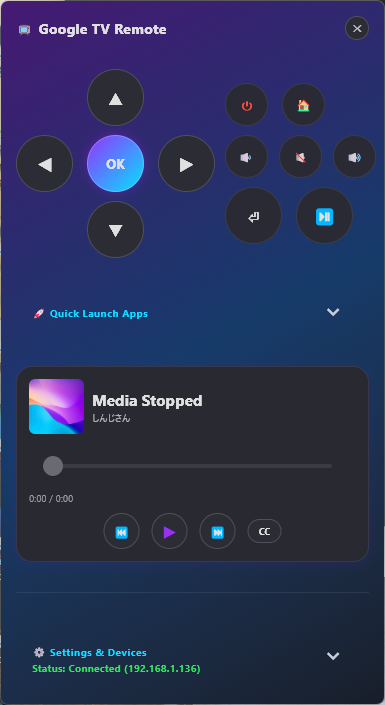
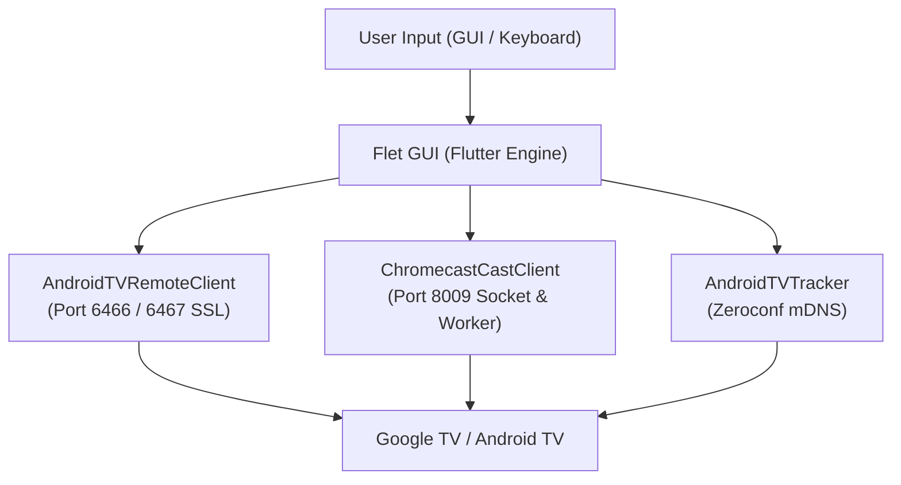

# ChromecastRemoteControl

English | [日本語 (Japanese)](README.md)

A lightweight, feature-rich desktop remote control and media controller for Chromecast with Google TV, Google TV Streamer, and Android TV devices.  
Built with Python and [Flet](https://flet.dev/) (powered by the Flutter engine), providing a native-like modern desktop experience.

<p align="center">
  
</p>

---

## Features

- **Full Remote Navigation (Android TV Remote v2)**
  - D-Pad (Up, Down, Left, Right), Enter, Back, Home, Power, Volume Up/Down, and Mute
  - Keyboard shortcut support (Arrow keys, Enter, Esc, Space, Volume keys, etc.)
  - Accurate short-tap and long-press repeat key detection (sends standard OS key events identical to physical remotes)
  - **Hold-to-Accelerate Fast-Forward**: Holding Left/Right keys triggers native accelerated seek (2x speed / rapid seek) just like the physical remote
- **YouTube Direct Search (YouTube Search)**
  - Enter keywords from your PC keyboard via the search accordion to instantly deep-link to YouTube search results from any screen or active playback
  - Completely eliminates the need to fumble with clumsy TV on-screen keyboards
  - One-click launcher for major streaming apps (YouTube, Netflix, Prime Video, etc.)
- **Google Cast Media Integration (pychromecast)**
  - Real-time media metadata synchronization (Title, Artist, Album Art, Progress, Duration)
  - Play / Pause, Next / Previous, and interactive seek bar scrubbing
  - One-click Subtitle / Closed Caption toggle
  - Smooth auto-marquee scrolling for long media titles
- **Multilingual Support**
  - **Automatic Preferred Language Subtitles**: Automatically detects and applies subtitle tracks matching your preferred language code (e.g., Japanese `ja`, English `en`) when cast playback begins
  - **Dynamic Language Selection**: Change your preferred language instantly from the in-app settings
  - **Bilingual Documentation**: Fully documented in both English ([README_EN.md](README_EN.md)) and Japanese ([README.md](README.md))
- **Auto Device Discovery & Seamless Reconnection**
  - Automatic Android TV device discovery on the local network via mDNS (Zeroconf)
  - Automatic recovery and socket reconnection after PC sleep or hibernation
  - Auto-connect to the last active device on startup
- **Refined Desktop UI/UX**
  - Neon gradient cyberpunk dark theme
  - Dynamic scaling adapting to window resizing (font sizes and button layouts auto-scale)
  - Adjustable window opacity slider
  - Low-overhead buffered memory logging

---

## Architecture



---

## Requirements

- **OS**: Windows 10 / 11 (64-bit)
- **Python**: 3.10 or higher (Python 3.12 recommended)
- **Target Device**: Google TV Streamer, Chromecast with Google TV, or any Android TV OS smart TV/device connected to the same local network

---

## Supported Devices & Architecture Differences (Important)

This application is designed **exclusively for devices running Google TV or Android TV OS**.  
Legacy Chromecast models (1st to 3rd generation, Chromecast Ultra) and modern Google TV devices (Chromecast with Google TV, Google TV Streamer) have fundamentally different operating systems and protocol stacks.

### Device Compatibility Matrix

| Device Model | Release Year | Operating System | Remote Navigation<br>(Port 6467) | Media Sync<br>(Port 8009) | Status |
| :--- | :---: | :--- | :---: | :---: | :---: |
| **Google TV Streamer (4K)** | 2024 | Google TV (Android 14) | ✅ Full Support | ✅ Full Support | **Supported (Recommended)** |
| **Chromecast with Google TV (4K)** | 2020 | Google TV (Android 10–12) | ✅ Full Support | ✅ Full Support | **Supported (Recommended)** |
| **Chromecast with Google TV (HD)** | 2022 | Google TV (Android 12) | ✅ Full Support | ✅ Full Support | **Supported (Recommended)** |
| **Android TV / Google TV Smart TVs & STBs**<br>(BRAVIA, AQUOS, VIERA, REGZA, TCL, SHIELD TV, etc.) | - | Android TV / Google TV | ✅ Full Support | ✅ Full Support | **Supported** |
| **Chromecast Ultra (4K)** | 2016 | Embedded Cast OS (Linux/Chrome) | ❌ Not Available | ⚠️ Partial Only | **Unsupported** |
| **Chromecast (3rd Gen)** | 2018 | Embedded Cast OS (Linux/Chrome) | ❌ Not Available | ⚠️ Partial Only | **Unsupported** |
| **Chromecast (2nd Gen)** | 2015 | Embedded Cast OS (Linux/Chrome) | ❌ Not Available | ⚠️ Partial Only | **Unsupported** |
| **Chromecast (1st Gen)** | 2013 | Embedded Cast OS (Linux/Chrome) | ❌ Not Available | ⚠️ Partial Only | **Unsupported** |
| **Chromecast Audio** | 2015 | Embedded Cast OS (Linux/Chrome) | ❌ Not Available | ⚠️ Partial Only | **Unsupported** |

### Why Legacy Chromecast (1st–3rd Gen / Ultra) Is Unsupported

1. **Absence of Android TV Remote Protocol (Port 6467)**:
   - Legacy Chromecast models and Chromecast Ultra run a lightweight receiver OS designed solely for browser-like Cast rendering, lacking an underlying Android operating system.
   - Consequently, the remote navigation service (`_androidtvremote2._tcp.local.`) that powers D-Pad navigation, Home, Back, Power, Volume, and app launching is not present on these devices.
2. **mDNS Auto-Discovery Behavior**:
   - The app's network scanner searches specifically for Android TV Remote v2 endpoints. Legacy Cast-only devices will not be listed in the device selector.
3. **Unified Remote Input Architecture**:
   - All navigation and media skip/fast-forward actions send standard Android OS key events identical to the official physical remote, preventing ANRs and app freezing. Because legacy Chromecasts lack an OS-level key dispatch system, remote control is not supported.

---

## Quick Start / Download (Recommended)

Pre-built standalone Windows executables (EXE) are provided so you can run the app without installing Python.

1. **Download ZIP**:  
   Download the latest `GoogleTVRemote_v1.1.0_win64.zip` from [GitHub Releases](https://github.com/Zaki-XL/ChromecastRemoteControl/releases).
2. **Extract**:  
   Extract (unzip) the archive to any folder of your choice (e.g., in Documents or Desktop).
3. **Launch**:  
   Double-click `GoogleTVRemote.exe` inside the extracted folder to run the application immediately.

---

## Uninstallation

This application is designed as a completely **portable** application. It does not touch your Windows registry or create files in system directories (such as AppData).

- All runtime files, including the configuration (`config.ini`) and SSL pairing certificates (`certs/`), are kept **within the application folder**.
- To uninstall, simply **delete the extracted folder**. No residual files or registry keys will remain on your computer.

---

## Setup & Run from Source (Developers)

If you prefer to run or build the application from source code using Python:

### 1. Clone the repository
```bash
git clone https://github.com/Zaki-XL/ChromecastRemoteControl.git
cd ChromecastRemoteControl
```

### 2. Create virtual environment and install dependencies
```bash
python -m venv .venv
.venv\Scripts\activate
pip install -r requirements.txt
```

### 3. Configuration
`config.ini` is automatically generated on the first run. You can also refer to `config.example.ini` for manual customization.

### 4. Run Application
```bash
python main.py
```

---

## How to Pair & Use

1. Launch the application. Nearby Android TV and Chromecast devices will be discovered and shown as chips at the top.
2. On your first connection to a device, a **6-digit pairing PIN** will appear on your TV screen.
3. Enter the PIN into the pairing dialog in the app and submit. SSL certificates will be saved to `certs/` for seamless automatic authentication in future sessions.
4. Control your TV using the on-screen remote or keyboard shortcuts.

---

## Multilingual & Subtitle Settings

Inside the **Settings & Devices** accordion, you will find the **Preferred Language** configuration.

- **Supported Codes**: Japanese (`ja`), English (`en`), etc.
- **Behavior**:
  - When media streaming starts, the app automatically enables subtitles matching your preferred language if an appropriate track is present.
  - You can also toggle subtitles ON or OFF at any time using the "CC" button in the bottom playback control bar.

---

## Keyboard Shortcuts

| Key | Action |
| :--- | :--- |
| `↑` `↓` `←` `→` | D-Pad Navigation |
| `Enter` | Select (OK / Enter) |
| `Backspace` / `Escape` | Back |
| `Home` | Home Screen |
| `Space` | Play / Pause |
| `Page Up` / `+` | Volume Up |
| `Page Down` / `-` | Volume Down |
| `M` | Mute Toggle |

---

## Standalone EXE Build

Build a standalone, single-file Windows executable (`GoogleTVRemote.exe`) via PyInstaller:

```powershell
powershell -ExecutionPolicy Bypass -File build_app.ps1
```
The compiled executable will be placed in the root directory and `dist/`.

---

## Project Structure

```text
ChromecastRemoteControl/
├── main.py                  # Root application entry point
├── src/                     # Core production source directory
│   ├── __init__.py          # Package initialization
│   ├── main.py              # Application entry point & Flet GUI layout
│   ├── cast_client.py       # pychromecast wrapper (Media sync & worker thread)
│   ├── remote_client.py     # androidtvremote2 wrapper (Remote control & SSL)
│   ├── device_tracker.py    # Zeroconf mDNS auto-discovery service
│   └── config_manager.py    # Configuration loader & manager
├── requirements.txt         # Python dependency specifications
├── build_app.ps1            # PyInstaller build automation script
├── build.bat                # Batch launcher for build
├── config.example.ini       # Configuration template
├── README.md                # Japanese documentation
├── README_EN.md             # English documentation
└── LICENSE                  # MIT License
```

---

## License

This project is licensed under the [MIT License](LICENSE).
