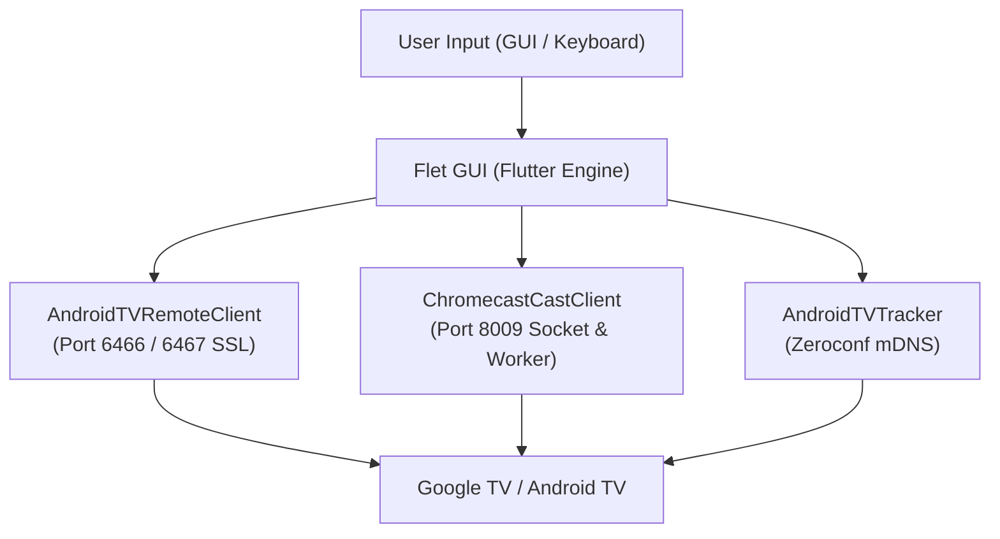

# ChromecastRemoteControl

English | [日本語 (Japanese)](README.md)

A lightweight, feature-rich desktop remote control and media controller for Chromecast with Google TV and Android TV devices.  
Built with Python and [Flet](https://flet.dev/) (powered by the Flutter engine), providing a native-like modern desktop experience.

---

## Features

- **Full Remote Navigation (Android TV Remote v2)**
  - D-Pad (Up, Down, Left, Right), Enter, Back, Home, Power, Volume Up/Down, and Mute
  - Keyboard shortcut support (Arrow keys, Enter, Esc, Space, Volume keys, etc.)
  - Accurate short-tap and long-press repeat key detection
  - One-click launcher for major streaming apps (YouTube, Netflix, Prime Video, etc.)
- **Google Cast Media Integration (pychromecast)**
  - Real-time media metadata synchronization (Title, Artist, Album Art, Progress, Duration)
  - Play / Pause, Next / Previous, and interactive seek bar scrubbing
  - One-click Subtitle / Closed Caption toggle
  - Smooth auto-marquee scrolling for long media titles
- **Multilingual Support**
  - **Automatic Preferred Language Subtitles**: Automatically detects and applies subtitle tracks matching your preferred language code (e.g., Japanese `ja`, English `en`) when cast playback begins
  - **Dynamic Language Selection**: Change your preferred language instantly from the in-app settings
  - **Bilingual Documentation**: Fully documented in both English ([README_EN.md](README_EN.md)) and Japanese ([README.md](README.md))
- **Auto Device Discovery & Seamless Reconnection**
  - Automatic Android TV device discovery on the local network via mDNS (Zeroconf)
  - Automatic recovery and socket reconnection after PC sleep or hibernation
  - Auto-connect to the last active device on startup
- **Refined Desktop UI/UX**
  - Neon gradient cyberpunk dark theme
  - Dynamic scaling adapting to window resizing (font sizes and button layouts auto-scale)
  - Adjustable window opacity slider
  - Low-overhead buffered memory logging

---

## Architecture



---

## Requirements

- **OS**: Windows 10 / 11 (64-bit)
- **Python**: 3.10 or higher (Python 3.12 recommended)
- **Target Device**: Chromecast with Google TV or any Android TV device connected to the same local network

---

## Setup & Installation

### 1. Clone the repository
```bash
git clone https://github.com/Zaki-XL/ChromecastRemoteControl.git
cd ChromecastRemoteControl
```

### 2. Create virtual environment and install dependencies
```bash
python -m venv .venv
.venv\Scripts\activate
pip install -r requirements.txt
```

### 3. Configuration
`config.ini` is automatically generated on the first run. You can also refer to `config.example.ini` for manual customization.

### 4. Run Application
```bash
python main.py
```

---

## How to Pair & Use

1. Launch the application. Nearby Android TV and Chromecast devices will be discovered and shown as chips at the top.
2. On your first connection to a device, a **6-digit pairing PIN** will appear on your TV screen.
3. Enter the PIN into the pairing dialog in the app and submit. SSL certificates will be saved to `certs/` for seamless automatic authentication in future sessions.
4. Control your TV using the on-screen remote or keyboard shortcuts.

---

## Multilingual & Subtitle Settings

Inside the **Settings & Devices** accordion, you will find the **Preferred Language** configuration.

- **Supported Codes**: Japanese (`ja`), English (`en`), etc.
- **Behavior**:
  - When media streaming starts, the app automatically enables subtitles matching your preferred language if an appropriate track is present.
  - You can also toggle subtitles ON or OFF at any time using the "CC" button in the bottom playback control bar.

---

## Keyboard Shortcuts

| Key | Action |
| :--- | :--- |
| `↑` `↓` `←` `→` | D-Pad Navigation |
| `Enter` | Select (OK / Enter) |
| `Backspace` / `Escape` | Back |
| `Home` | Home Screen |
| `Space` | Play / Pause |
| `Page Up` / `+` | Volume Up |
| `Page Down` / `-` | Volume Down |
| `M` | Mute Toggle |

---

## Standalone EXE Build

Build a standalone, single-file Windows executable (`GoogleTVRemote.exe`) via PyInstaller:

```powershell
powershell -ExecutionPolicy Bypass -File build_app.ps1
```
The compiled executable will be placed in the root directory and `dist/`.

---

## Project Structure

```text
ChromecastRemoteControl/
├── main.py              # Application entry point & Flet GUI layout
├── cast_client.py       # pychromecast wrapper (Media sync & worker thread)
├── remote_client.py     # androidtvremote2 wrapper (Remote control & SSL)
├── device_tracker.py    # Zeroconf mDNS auto-discovery service
├── config_manager.py    # Configuration loader & manager
├── requirements.txt     # Python dependency specifications
├── build_app.ps1        # PyInstaller build automation script
├── build.bat            # Batch launcher for build
├── config.example.ini   # Configuration template
├── README.md            # Japanese documentation
├── README_EN.md         # English documentation
└── LICENSE              # MIT License
```

---

## License

This project is licensed under the [MIT License](LICENSE).
